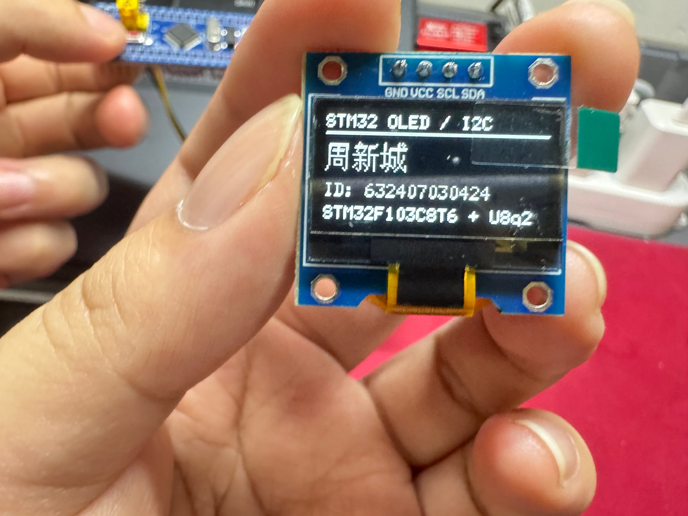
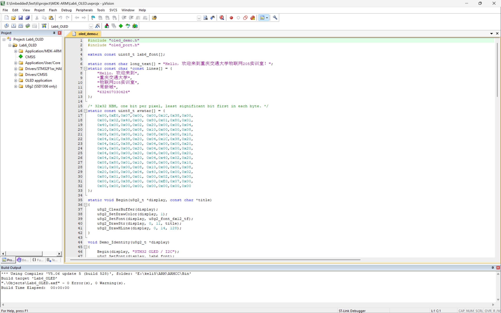

# STM32F103 + 0.96 寸 I2C OLED：汉字显示与 U8g2 移植

实验六工程。主控为 STM32F103C8T6，显示屏为 0.96 寸 128×64 四针 I2C OLED（SSD1306），在 CubeMX 生成的 HAL 框架中完成姓名学号显示、长句滚动、图形 demo、动态图案和 U8g2 移植。



## 功能

- 姓名、学号与板卡信息显示；
- 337 像素长句“Hello，欢迎来到重庆交通大学物联网205实训室！”左右滚动；
- 多行中文与学号上下滚动，标题区域固定；
- U8g2 图形 demo：边框、矩形、圆、实心圆、直线、动态进度条；
- 32×32 XBM 笑脸左右往返、上下浮动、眨眼；
- SSD1306 硬件左滚/右滚，上半屏固定；
- I2C 地址 `0x3C` 自动探测，失败回退 `0x3D`，无屏时每 500 ms 重试。

## 硬件与接线

| OLED 丝印 | STM32F103C8T6 | 说明 |
| --- | --- | --- |
| GND | GND | 共地 |
| VCC | 3.3 V | 不要接 5 V |
| SCL | PB10 / I2C2_SCL | 开漏，需上拉 |
| SDA | PB11 / I2C2_SDA | 开漏，需上拉 |

模块一般自带上拉；若没有，SCL、SDA 各接 4.7 kΩ 到 3.3 V。开发板与 ST-LINK 只保留一个供电源。

调试使用 SWD：SWDIO 接 PA13，SWCLK 接 PA14，GND 共地，BOOT0 保持 0。

## 软件环境

| 项目 | 版本 |
| --- | --- |
| Keil µVision | 5，ARM Compiler 5.06 update 5（ARMCC5） |
| STM32CubeMX | 6.18.1 |
| STM32Cube FW_F1 | V1.8.0 |
| U8g2 | 上游提交 `d6c8499c5f2707cac8eccd09fd8f677d12b17977` |
| 芯片包 | Keil.STM32F1xx_DFP 2.2.0 |

系统时钟使用内部 HSI 经 PLL ×16 得到 64 MHz，APB1 为 32 MHz，I2C2 为 400 kHz。中文源文件以 UTF-8 保存，Keil C/C++ 选项保留 `--no_multibyte_chars`。

## 编译与烧录

1. 打开 `project/MDK-ARM/Lab6_OLED.uvprojx`；
2. 按 F7 编译，输出 `project/MDK-ARM/Objects/Lab6_OLED.hex`；
3. 用 ST-LINK 通过 SWD 下载，起始地址 `0x08000000`。

完整重建结果为 0 错误、0 警告：

```text
Program Size: Code=11648 RO-data=5204 RW-data=28 ZI-data=4044
".\Objects\Lab6_OLED.axf" - 0 Error(s), 0 Warning(s).
```



## 目录

```text
project/                 Keil 工程、CubeMX 配置、HAL、U8g2 裁剪源码、字库
project/Core/Src/oled_port.c    U8g2 的 HAL I2C/延时适配、地址探测、硬件滚屏
project/Core/Src/oled_demo.c    姓名学号、图形 demo、滚动与动画
project/Core/Src/lab6_font.c    16 像素中文子集字库，2259 字节
project/Middlewares/U8g2        裁剪后的 U8g2 C 源码
project/Assets/                 字体子集 BDF 与码点表
picture/                        过程截图、软件渲染图、上板实拍
report/                         实验报告 Markdown 与 PDF
blog/                           博客草稿与配图
Lab6_OLED_Project.zip           完整工程压缩包
```

## 显示顺序

上电后自动循环，无需按键：

1. 姓名学号页，停留 3 秒；
2. U8g2 图形 demo，123 帧；
3. 长句先向左、再向右滚动；
4. 多行中文与学号先向上、再向下滚动；
5. 32×32 笑脸左右往返、上下浮动、眨眼；
6. SSD1306 硬件左滚、右滚各约 4 秒，上半屏固定。

## 验证范围

- 姓名学号页已在实际硬件上显示并拍照；
- 编译为 0 错误、0 警告，ST-LINK 下载输出 `Programming Done`、`Verify OK`；
- 长句滚动、上下滚动、图形 demo、动画和硬件滚屏使用 Unicorn 加载编译后的 ARM 函数，将 HAL I2C 与延时替换为桩函数，还原 1024 字节显存为 128×64 位图进行核对；检查了 `0x3C`/`0x3D` 地址、21 个汉字字模、337 像素长句、负坐标裁剪、标题固定、图案帧变化和滚动命令字节；
- 软件核对不验证 SCL/SDA 实际电平、上升沿、ACK 时序和控制器批次差异；
- AHT20 温湿度与任务二的示波器/逻辑分析仪实测未做，报告中未使用虚构数据。

## 文档

- 实验报告：[report/OLED 周新城 632407030424.md](report/OLED%20周新城%20632407030424.md)、[PDF](report/OLED%20周新城%20632407030424.pdf)
- 博客草稿：[blog/STM32-OLED-U8g2-博客草稿.md](blog/STM32-OLED-U8g2-博客草稿.md)
- CSDN 草稿（需登录）：https://editor.csdn.net/md/?articleId=169155709

## 第三方与许可

- STM32 HAL/CMSIS：STMicroelectronics，BSD-3-Clause / Apache-2.0；
- U8g2：BSD 风格许可，见 `project/Middlewares/U8g2/LICENSE`；
- 文泉驿点阵宋体：GPL v2 with font embedding exception，原版权头保留在 `project/Assets/lab6_subset.bdf`；
- 6×12 ASCII 字体：U8g2 `u8g2_font_6x12_tf`，源文件注明 public domain。

第三方材料仍遵循其原许可证。
