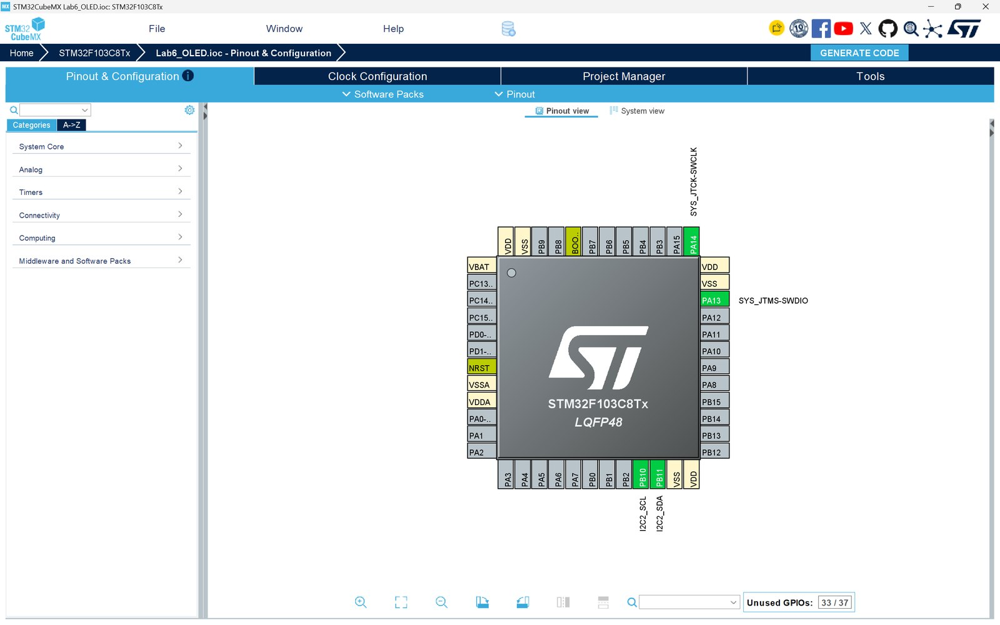
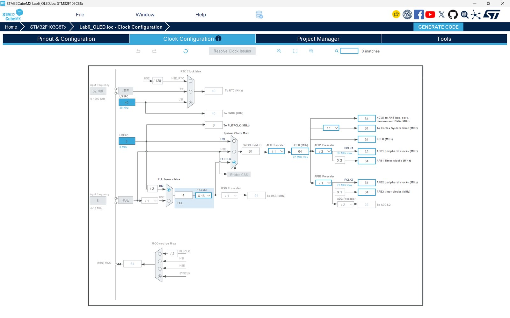
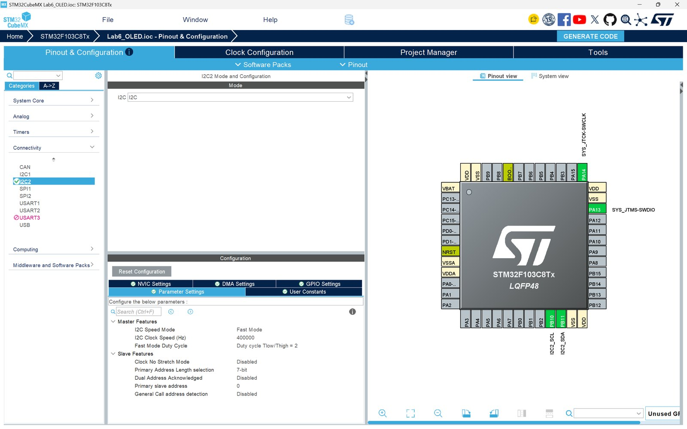
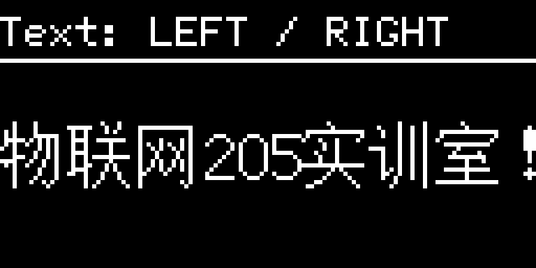
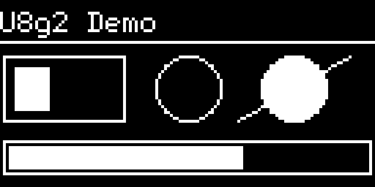
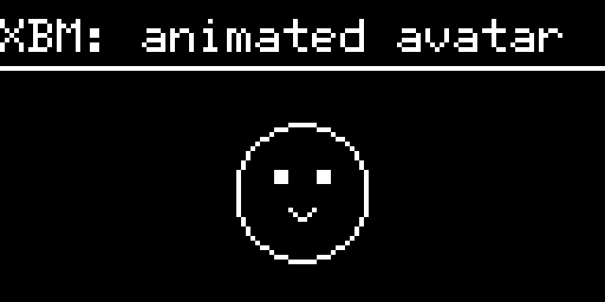
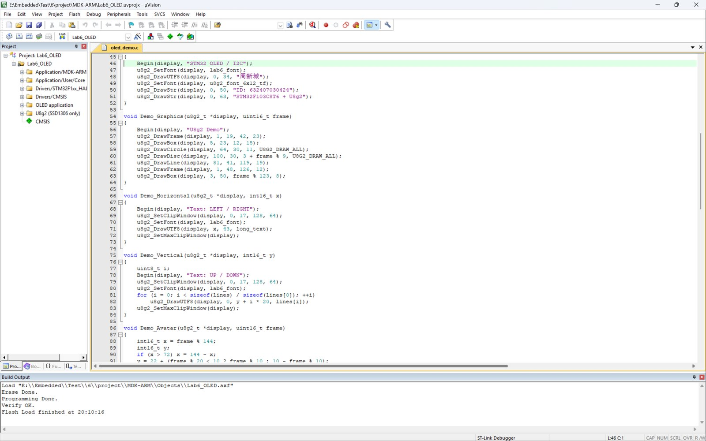

# STM32F103 驱动 0.96 寸 OLED：I2C 显示、汉字点阵与 U8g2 移植

本文记录 STM32F103C8T6 通过 I2C 驱动 0.96 寸 SSD1306 OLED 的过程，包括 CubeMX 配置、汉字点阵字库、U8g2 裁剪移植、长句滚动和 XBM 动画，并说明 Keil 虚拟逻辑分析仪为什么采不到真实 I2C 波形。完整工程、报告和上板演示见文末。

---


## 一、硬件与工具

| 项目 | 配置 |
| --- | --- |
| 主控 | STM32F103C8T6，LQFP48，64 KB Flash，20 KB RAM |
| 显示屏 | 0.96 寸 OLED，128×64，四针 I2C，SSD1306 |
| 开发环境 | Keil µVision 5，ARM Compiler 5.06 update 5 |
| 生成工具 | STM32CubeMX 6.18.1，STM32Cube FW_F1 V1.8.0 |
| 图形库 | U8g2，提交 `d6c8499`，仅保留 C 源码 |
| 调试器 | ST-LINK，SWD 接口 |

接线按模块丝印来：

| OLED | STM32F103C8T6 |
| --- | --- |
| GND | GND |
| VCC | 3.3 V |
| SCL | PB10 / I2C2_SCL |
| SDA | PB11 / I2C2_SDA |

四针模块一般自带上拉，若没有，SCL、SDA 各接一只 4.7 kΩ 到 3.3 V。SCL/SDA 是开漏信号，不能按推挽输出理解。开发板和 ST-LINK 只保留一个供电来源，避免两个 3.3 V 顶在一起。

选 I2C2 而不是 I2C1，主要是 PB10/PB11 在手边板子上引出方便，同时避开 PA13/PA14 的 SWD 引脚。I2C1 的 PB6/PB7 也能用，改接线和 CubeMX 配置即可。

## 二、I2C 与 SSD1306 的关键点

I2C 的电气部分是两根开漏线加外部上拉。SCL 为高时，SDA 由高变低是 START；SCL 为高时，SDA 由低变高是 STOP；普通数据位要求在 SCL 高电平期间保持稳定，只在 SCL 低电平期间变化。每 8 位数据后面跟一个应答位，第 9 个时钟由从机把 SDA 拉低表示 ACK。

SSD1306 的七位地址通常是 `0x3C`，写方向时左移一位得到 `0x78`；也有模块用 `0x3D`。HAL 的 `HAL_I2C_Master_Transmit()` 传入的是已经左移的八位地址，U8g2 的 `u8g2_SetI2CAddress()` 同样按八位地址处理，这一点如果混淆，现象就是“地址对了但屏幕没反应”。

一次写操作的数据流是：START、地址字节、ACK、控制字节、ACK、若干命令或数据、STOP。控制字节 `0x00` 表示后面是命令流，`0x40` 表示后面是显存数据。U8g2 的 `u8x8_cad_ssd13xx_fast_i2c` 已经处理好控制字节，移植时只需要把“一串字节”通过 HAL 发出去。

128×64 单色屏按每像素 1 bit 计算，全屏 1024 字节。SSD1306 把垂直方向相邻的 8 个像素打包成一个字节，整个屏幕分成 8 页（page 0～7），每页 128 列。字节的 bit0 对应这一页最上面的像素，bit7 对应最下面。理解这个布局，后面看 U8g2 的 `u8g2_ll_hvline_vertical_top_lsb` 就不会陌生。

## 三、CubeMX 建框架

新建工程时选 `STM32F103C8Tx`，在 Pinout 里打开：

- `SYS → Debug` 选 `Serial Wire`，保留 PA13/PA14；
- `Connectivity → I2C2` 选 `I2C`，PB10 自动成为 SCL，PB11 成为 SDA；
- I2C2 参数：Fast Mode，Clock Speed 400000 Hz，Duty Cycle 2；
- RCC 使用 HSI，PLL Source 选 HSI/2，PLLMul 选 ×16，SYSCLK 64 MHz；
- APB1 分频 2，得到 32 MHz；APB2 不分频，64 MHz。



内部 HSI 经 PLL 得到 64 MHz，不依赖板载外部晶振，最小系统板没有焊晶振也能跑。64 MHz 下 APB1 为 32 MHz，I2C2 的 400 kHz 在 HAL 的时序计算范围内。



I2C2 的具体参数如下。Fast Mode 的 Duty Cycle 选 2，SCL 低电平时间约为高电平的两倍，这是 400 kHz 模式下比较稳妥的占空比。



Project Manager 里把 Toolchain 选成 `MDK-ARM V5`，堆栈保持 CubeMX 默认的 Heap 0x200、Stack 0x800。生成代码后不要急着手写 `main.c`，先编译一次，确认 CubeMX 生成的框架本身没有问题。

时钟这里有一个细节：USB 预分频后得到的是 64 MHz，不满足 USB 需要的 48 MHz。本实验不使用 USB，所以没有影响；如果后续要加 USB，时钟树需要重新分配。

## 四、字库：从 UTF-8 到点阵

汉字在源文件里是 UTF-8 编码，一个汉字通常占 3 个字节。这 3 个字节只是字符编号，不是像素。要把“周”显示到屏幕上，需要按 Unicode 码点找到对应的点阵数据，再逐位画进显存。U8g2 的 `u8g2_DrawUTF8()` 做的就是这个解码和查表过程。

实验用 16 像素高的文泉驿点阵宋体，从 BDF 字库里只取需要的字符，用 U8g2 自带的 `bdfconv` 转成 C 数组。保留下来的字符是 95 个 ASCII 加 21 个非 ASCII：

```
周 新 城 欢 迎 来 到 重 庆 交 通 大 学 物 联 网 实 训 室 ！ ，
```

对应码点：

| 字符 | Unicode | 字符 | Unicode |
| --- | --- | --- | --- |
| 周 | 0x5468 | 新 | 0x65B0 |
| 城 | 0x57CE | 欢 | 0x6B22 |
| 迎 | 0x8FCE | 来 | 0x6765 |
| 到 | 0x5230 | 重 | 0x91CD |
| 庆 | 0x5E86 | 交 | 0x4EA4 |
| 通 | 0x901A | 大 | 0x5927 |
| 学 | 0x5B66 | 物 | 0x7269 |
| 联 | 0x8054 | 网 | 0x7F51 |
| 实 | 0x5B9E | 训 | 0x8BAD |
| 室 | 0x5BA4 | ！ | 0xFF01 |
| ， | 0xFF0C |  |  |

生成的字库是 2259 字节，放在 `Core/Src/lab6_font.c`，声明为 `const uint8_t lab6_font[]`，通过 `u8g2_SetFont()` 切换。ASCII 另用 U8g2 自带的 6×12 字体，标题和学号用这套，中文用 16 像素字库。

这里有一个容易忽略的限制：字库是子集，换名字或改句子时，如果新字符不在子集里，屏幕上会直接缺字，不会自动从系统字体里找。改显示内容前先确认字符是否在字库里，不在就重新生成 BDF 子集，不能只改 C 字符串。

## 五、任务一：三页显示与两种滚动

### 5.1 学号与姓名

第一页显示姓名、学号和板卡信息，布局是标题、分隔线、中文名、学号、芯片型号。中文名用 16 像素字库，学号用 6×12 ASCII 字体，避免数字占太高。

```c
void Demo_Identity(u8g2_t *display)
{
    Begin(display, "STM32 OLED / I2C");
    u8g2_SetFont(display, lab6_font);
    u8g2_DrawUTF8(display, 0, 34, "周新城");
    u8g2_SetFont(display, u8g2_font_6x12_tf);
    u8g2_DrawStr(display, 0, 50, "ID: 632407030424");
    u8g2_DrawStr(display, 0, 63, "STM32F103C8T6 + U8g2");
}
```

`Begin()` 负责清屏、设绘制色、画标题和横线：

```c
static void Begin(u8g2_t *display, const char *title)
{
    u8g2_ClearBuffer(display);
    u8g2_SetDrawColor(display, 1);
    u8g2_SetFont(display, u8g2_font_6x12_tf);
    u8g2_DrawStr(display, 0, 11, title);
    u8g2_DrawHLine(display, 0, 14, 128);
}
```

姓名学号页已经上板实拍，就是文首那张图。字模、坐标和换行都对得上，说明 I2C 地址、初始化序列和显存布局没有问题。

### 5.2 长句左右滚动

要滚动的句子是：

```
Hello，欢迎来到重庆交通大学物联网205实训室！
```

按 16 像素字库计算，整句宽度 337 像素，屏幕只有 128 像素，必然要移动。做法不是把整句塞进显存再让屏幕滚，而是每帧改变绘制起点 `x`，只把落在屏幕内的部分画出来：

```c
void Demo_Horizontal(u8g2_t *display, int16_t x)
{
    Begin(display, "Text: LEFT / RIGHT");
    u8g2_SetClipWindow(display, 0, 17, 128, 64);
    u8g2_SetFont(display, lab6_font);
    u8g2_DrawUTF8(display, x, 43, long_text);
    u8g2_SetMaxClipWindow(display);
}
```

`u8g2_SetClipWindow()` 把绘图区限制在标题线以下，x 从 0 减到 `128 - 337 = -209`，再从 -209 加回 0。步长 1 像素，每帧延时 15 ms，视觉上比较连续。负坐标由 U8g2 的裁剪逻辑处理，不需要手动算哪一段可见。




两张图分别是起点和终点。注意标题栏没有跟着动，因为裁剪窗口从 y=17 开始；如果忘了恢复 `u8g2_SetMaxClipWindow()`，后续页面会一直被裁在窗口里。

### 5.3 上下滚动

上下滚动用同一个思路，把五行文字整体沿 y 方向移动，标题固定：

```c
void Demo_Vertical(u8g2_t *display, int16_t y)
{
    uint8_t i;
    Begin(display, "Text: UP / DOWN");
    u8g2_SetClipWindow(display, 0, 17, 128, 64);
    u8g2_SetFont(display, lab6_font);
    for (i = 0; i < sizeof(lines) / sizeof(lines[0]); ++i)
        u8g2_DrawUTF8(display, 0, y + i * 20, lines[i]);
    u8g2_SetMaxClipWindow(display);
}
```

`y` 从 63 减到 -64，再回到 63。行距 20 像素，16 像素字加上 4 像素间隙，五行内容刚好能在屏幕里完整过一遍。


### 5.4 SSD1306 硬件滚屏

软件滚动靠每帧重画，CPU 一直在写显存。SSD1306 还提供硬件滚屏：发一条滚动设置命令，控制器自己移动显存内容，MCU 可以去做别的事。

水平滚动的命令序列是：

```c
void OLED_ScrollStart(uint8_t left)
{
    /* 只滚 page 4..7，page 0..3 固定 */
    uint8_t command[] = {0x00, 0x2E, 0x27, 0x00, 0x04,
                         0x00, 0x07, 0x00, 0xFF, 0x2F};
    command[2] = left ? 0x27 : 0x26;
    oled_i2c_status = HAL_I2C_Master_Transmit(
        &hi2c2, oled_address, command, sizeof(command), 100);
}
```

`0x2E` 先停止上一次滚动，`0x27` 是向左，`0x26` 是向右，`0x04`/`0x07` 是起止页，`0x2F` 启动。第一个字节 `0x00` 是控制字节，告诉 SSD1306 后面是命令。

硬件滚屏和软件滚动不是一回事：硬件滚屏只能移动显存里已经存在的内容，不能凭空把 337 像素宽的长句“存”进去。长句滚动仍然要用坐标移动；硬件滚屏适合整页已经写好、只需要平移的场景，比如下半屏的姓名和学号。

停止滚屏后要重新写一次显存。SSD1306 在滚动期间显存指针和显示内容会错位，直接接着画容易出现花屏或偏移：

```c
OLED_ScrollStop();
u8g2_SendBuffer(display);   /* 停止后重写 1024 字节显存 */
```


### 5.5 关于 AHT20

任务一还要求显示 AHT20 的温湿度。本次手头没有 AHT20 模块，这一项没有接入固件，代码里也没有伪造温湿度数据。AHT20 与 OLED 可以挂在同一条 I2C2 总线上，七位地址 `0x38`，触发测量发 `0xAC 0x33 0x00`，等待约 80 ms 后读 6 个字节，再按 20 位原始值换算温度和湿度。等模块到手，补一个 `aht20.c` 和一行显示即可，不需要改 OLED 部分。

## 六、任务三：把 U8g2 裁到能跑

U8g2 原仓库同时包含 Arduino、C++、多种显示控制器和大量字体，直接整个塞进 Keil 工程会带进一堆用不到的文件。裁剪的原则是：只保留 SSD1306、128×64、I2C、全屏缓冲这条路径需要的 C 文件。

保留的模块大致分三层：

- 应用层：`u8g2_box.c`、`u8g2_circle.c`、`u8g2_line.c`、`u8g2_bitmap.c`、`u8g2_font.c` 等；
- 驱动层：`u8x8_d_ssd1306_128x64_noname.c`、`u8x8_cad.c`、`u8x8_byte.c`、`u8x8_display.c`；
- 适配层：`u8g2_d_setup.c`、`u8g2_d_memory.c`、`u8g2_setup.c`、`u8g2_buffer.c`。

`u8g2_d_setup.c` 只留一个初始化函数：

```c
void u8g2_Setup_ssd1306_i2c_128x64_noname_f(
    u8g2_t *u8g2, const u8g2_cb_t *rotation,
    u8x8_msg_cb byte_cb, u8x8_msg_cb gpio_and_delay_cb)
{
    uint8_t tile_buf_height;
    uint8_t *buf;
    u8g2_SetupDisplay(u8g2, u8x8_d_ssd1306_128x64_noname,
                      u8x8_cad_ssd13xx_fast_i2c,
                      byte_cb, gpio_and_delay_cb);
    buf = u8g2_m_16_8_f(&tile_buf_height);
    u8g2_SetupBuffer(u8g2, buf, tile_buf_height,
                     u8g2_ll_hvline_vertical_top_lsb, rotation);
}
```

`_f` 后缀表示全屏缓冲，`u8g2_m_16_8_f()` 提供 1024 字节静态数组：

```c
uint8_t *u8g2_m_16_8_f(uint8_t *page_cnt)
{
    static uint8_t buf[1024];
    *page_cnt = 8;
    return buf;
}
```

这 1024 字节是 U8g2 的显存副本，所有画线、画圆、写字先改这块内存，最后 `u8g2_SendBuffer()` 一次性通过 I2C 发到屏幕。STM32F103C8 只有 20 KB RAM，1024 字节可以接受，但也要留意栈和堆的余量。

I2C 适配层把 U8g2 的字节流攒进缓冲区，在传输结束时调用一次 HAL：

```c
static uint8_t I2C_Byte(u8x8_t *u8x8, uint8_t msg,
                        uint8_t count, void *data)
{
    static uint8_t buffer[128];
    static uint16_t used;
    switch (msg)
    {
    case U8X8_MSG_BYTE_INIT:
    case U8X8_MSG_BYTE_SET_DC:
        return 1;
    case U8X8_MSG_BYTE_START_TRANSFER:
        used = 0;
        return 1;
    case U8X8_MSG_BYTE_SEND:
        memcpy(buffer + used, data, count);
        used += count;
        return 1;
    case U8X8_MSG_BYTE_END_TRANSFER:
        oled_i2c_status = HAL_I2C_Master_Transmit(
            &hi2c2, oled_address, buffer, used, 100);
        return oled_i2c_status == HAL_OK;
    default:
        return 0;
    }
}
```

延时回调分三档：毫秒级直接用 `HAL_Delay()`，10 µs 和 100 ns 级用 DWT 的周期计数器忙等。DWT 需要先使能：

```c
CoreDebug->DEMCR |= CoreDebug_DEMCR_TRCENA_Msk;
DWT->CTRL |= DWT_CTRL_CYCCNTENA_Msk;
```

SSD1306 的初始化对延时不算苛刻，但 U8g2 的启动序列里确实有微秒级等待，全部用 `HAL_Delay(0)` 糊弄并不可靠。64 MHz 下 10 µs 是 640 个周期，DWT 的精度足够。

初始化时先探测地址，再决定用 `0x3C` 还是 `0x3D`：

```c
uint8_t OLED_Init(u8g2_t *display)
{
    oled_address = 0x3C << 1;
    HAL_Delay(100);
    if (HAL_I2C_IsDeviceReady(&hi2c2, oled_address, 2, 20) != HAL_OK)
    {
        oled_address = 0x3D << 1;
        if (HAL_I2C_IsDeviceReady(&hi2c2, oled_address, 2, 20) != HAL_OK)
            return 0;
    }
    u8g2_Setup_ssd1306_i2c_128x64_noname_f(
        display, U8G2_R0, I2C_Byte, GPIO_Delay);
    u8g2_SetI2CAddress(display, oled_address);
    u8g2_InitDisplay(display);
    u8g2_SetPowerSave(display, 0);
    u8g2_ClearBuffer(display);
    return oled_i2c_status == HAL_OK;
}
```

主程序里没有屏幕就每 500 ms 重试，不会因为 OLED 没插好而卡死：

```c
while (!OLED_Init(&display))
{
    HAL_Delay(500);
}
```

## 七、图形、图案与动画

U8g2 的 demo 页把常用的绘图 API 都过了一遍：边框、实心矩形、圆、实心圆、直线和进度条。进度条的长度用帧计数取模，形成循环动画。

```c
u8g2_DrawFrame(display, 1, 19, 42, 23);
u8g2_DrawBox(display, 5, 23, 12, 15);
u8g2_DrawCircle(display, 64, 30, 11, U8G2_DRAW_ALL);
u8g2_DrawDisc(display, 100, 30, 3 + frame % 9, U8G2_DRAW_ALL);
u8g2_DrawLine(display, 81, 41, 119, 19);
u8g2_DrawFrame(display, 1, 48, 126, 12);
u8g2_DrawBox(display, 3, 50, frame % 123, 8);
```



图案部分用一张 32×32 的 XBM 点阵，画的是笑脸。XBM 每个字节按低位优先表示横向 8 个像素，`u8g2_DrawXBM()` 会把它转成 SSD1306 的页式布局。动画让图案左右往返，同时上下浮动，每隔若干帧把眼睛区域擦掉再画一条横线，形成眨眼效果。

```c
void Demo_Avatar(u8g2_t *display, uint16_t frame)
{
    int16_t x = frame % 144;
    int16_t y;
    if (x > 72) x = 144 - x;
    y = 22 + (frame % 20 < 10 ? frame % 10 : 10 - frame % 10);
    Begin(display, "XBM: animated avatar");
    u8g2_DrawXBM(display, x + 12, y, 32, 32, avatar);
    if (frame % 30 < 5)
    {
        u8g2_SetDrawColor(display, 0);
        u8g2_DrawBox(display, x + 20, y + 10, 16, 3);
        u8g2_SetDrawColor(display, 1);
        u8g2_DrawHLine(display, x + 21, y + 11, 3);
        u8g2_DrawHLine(display, x + 33, y + 11, 3);
    }
}
```



## 八、编译、烧录与验证边界

Keil 里选择 ARMCC5，C99，优化等级 O3，预定义宏 `USE_HAL_DRIVER, STM32F103xB`。中文源文件需要 UTF-8 保存，并在 C/C++ 选项里加 `--no_multibyte_chars`，否则 ARMCC 可能按本地代码页解释字符串，出现乱码或编译报错。

完整重建结果：

```text
Program Size: Code=11648 RO-data=5204 RW-data=28 ZI-data=4044
".\Objects\Lab6_OLED.axf" - 0 Error(s), 0 Warning(s).
```

Flash 占用约 16.5 KiB，RAM 静态占用约 4 KiB（含 1024 字节 U8g2 缓冲、2 KB 栈和 512 字节堆）。64 KB Flash、20 KB RAM 的 C8T6 还有余量。


生成的 HEX 从 `0x08000000` 开始，用 ST-LINK 通过 SWD 下载。烧录日志：

```text
Erase Done.
Programming Done.
Verify OK.
Flash Load finished at 20:10:16
```



除了上板，还用 Unicorn 跑了编译后的 ARM 函数做软件核对：把 HAL I2C 和延时替换成桩函数，直接调用 `Demo_*`，把 1024 字节显存还原成 128×64 位图。检查项包括 `0x3C` 地址、`0x3D` 回退、无屏返回失败、21 个汉字字模、337 像素长句、负坐标裁剪、上下滚动时标题保持、图案帧变化和 SSD1306 滚动命令字节。

这一步能验证坐标、字模和命令序列，但不能替代电气测量：它不检查 SCL/SDA 的实际电平、上升沿、ACK 时序，也不验证 OLED 控制器的批次差异。文中除实拍图外的屏幕图，都是这套软件核对生成的 128×64 渲染图，不是用手机对着屏幕逐页拍的。


<iframe id="oledvideo-550117" frameborder="0" src="https://live.csdn.net/v/embed/550117" allowfullscreen="true" data-mediaembed="csdn"></iframe>

## 九、Keil 的逻辑分析仪能采到 I2C 吗

作业里有一个问题：如果用 Keil 的虚拟逻辑分析仪采集 I2C 的 SDA 引脚，波形是什么样；如果采不到真实协议，还能用什么方法。

先说结论：Keil 的 Logic Analyzer 不是协议分析仪，它跟踪的是调试器能读到的变量或表达式，比如 `GPIOB->ODR`、`PORTB` 或者自定义变量。它不会自动接上 SCL/SDA 做 I2C 解码，也不保证当前芯片包能仿真 I2C 外设和外接 OLED。

即使能在窗口里加上 PB11 并看到跳变，得到的也只是 0/1 电平序列：空闲时 SDA 为高，START 时在 SCL 高电平期间出现下降沿，随后是地址和数据的 8 位脉冲，第 9 位由从机拉低表示 ACK，最后 STOP 时 SDA 在 SCL 高电平期间上升。只看 SDA，START/STOP 和普通数据位的区别并不明显，位边界也要靠 SCL 才能确定；如果调试采样速率不够，400 kHz 的脉冲还会被漏采或混叠。

更关键的是，GPIO 配置成 I2C 复用开漏后，`ODR` 反映的是输出锁存器，不是引脚上的实际电平。从机在第 9 个时钟把 SDA 拉低应答，这个低电平不会出现在 `ODR` 里。所以就算 Keil 画出一条“像 I2C”的线，也不能把它当成总线波形。

可行的替代方法：

1. 外部逻辑分析仪。SCL、SDA、GND 三根线接上，采样率至少为总线频率的 10 倍，400 kHz 建议 4 MS/s 以上，软件里开 I2C 解码。Saleae Logic 16 这类工具可以直接把地址、数据、ACK 解出来，比肉眼看波形可靠。
2. 示波器。双通道同时看 SCL/SDA，触发设在 SDA 下降沿，量高电平、低电平、上升时间、时钟频率和建立/保持时间。示波器看电气特性，逻辑分析仪看协议内容，两者互补。
3. 没有仪器时，用软件 I2C 在 GPIO 上模拟，把每个阶段的状态用另一个引脚或串口打出来；或者用第二块 MCU 做总线嗅探。这样能验证字节序列和状态机，但仍然不是真实波形。
4. 只做功能验证时，读 I2C 状态寄存器的错误标志、统计 ACK 失败次数，也能定位“地址不对”“从机没响应”这类问题，但测不到时序余量。

本实验没有用 Keil 的逻辑分析仪声称采到了 I2C 波形，也没有任务二的实测数据。上面的结论来自调试器工作原理和 I2C 电气特性，不是示波器截图。

## 十、踩过的坑

**中文编译。** 源文件统一 UTF-8，Keil 的 C/C++ 选项加 `--no_multibyte_chars`。如果编辑器另存成 GBK，字符串会变成另一套字节，字库查不到对应码点，屏幕上就是空白或问号。

**重复定义 `U8G2_16BIT`。** 上游头文件和工程里的配置都定义了一次，编译报重定义。保留一处，另一处删掉或加条件编译。

**漏掉 `u8x8_capture.c`。** 新版 U8g2 的部分文件依赖它，裁剪时只看文件名容易漏。编译报未定义符号时，按报错把对应 C 文件补回 `U8g2` 分组。

**OLED 不应答。** 先量 VCC 和 GND，再确认 SCL/SDA 没有接反，然后试 `0x3C` 和 `0x3D`。模块自带上拉时不要再并一组强上拉；没有上拉时 4.7 kΩ 就够。地址写成 `0x3C` 而不是 `0x78` 是 HAL 调用里最常见的错误。

**硬件滚屏后花屏。** 停止滚动后要重写显存，否则显示指针停在偏移位置。滚动期间也不要频繁 `u8g2_SendBuffer()`，两者会打架。

**长句宽度。** 16 像素字库下这句话是 337 像素，不能按 128 像素去算步数。滚动终点是 `128 - 337`，不是 `128 - 128`。

**RAM 余量。** 1024 字节显存缓冲加上 2 KB 栈、512 字节堆，20 KB RAM 还够用，但再加文件系统或大数组就要重新算。

## 十一、小结

这次实验把几个环节串起来了：I2C 的电气时序、SSD1306 的页式显存、UTF-8 到点阵的映射、U8g2 的裁剪与回调适配，以及软件滚动和硬件滚屏的区别。姓名学号页已经上板显示，长句滚动、上下滚动、图形 demo 和 XBM 动画按同一套显存流程循环运行；AHT20 和任务二的实测没有做，文中没有把软件渲染图当成实物照片，也没有把 Keil 的变量跟踪当成 I2C 波形。

完整工程、字库子集、编译日志和过程截图放在 GitHub：

https://github.com/Gallagher1201/stm32-oled-u8g2-lab6

参考资料：

- [OLED 屏显与汉字点阵](https://blog.csdn.net/qq_45237293/article/details/111712565)
- [OLED 显示原理与字模](https://blog.csdn.net/qq_43279579/article/details/111414037)
- [基于 STM32 移植 U8g2 图形库（HAL 库）](https://blog.csdn.net/black_sneak/article/details/126312657)
- [U8g2 源码](https://github.com/olikraus/u8g2)
- [文泉驿点阵宋体](https://github.com/olikraus/u8g2/tree/d6c8499c5f2707cac8eccd09fd8f677d12b17977/tools/font/bdf)
