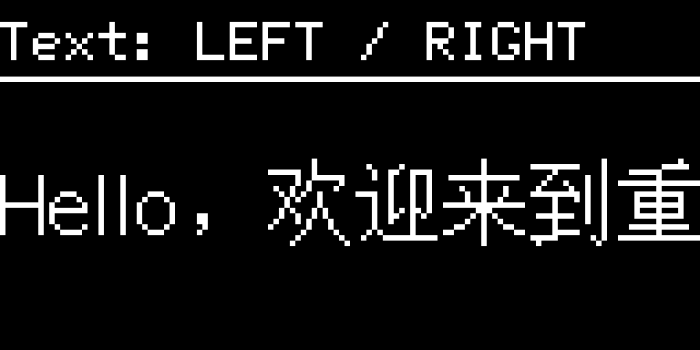
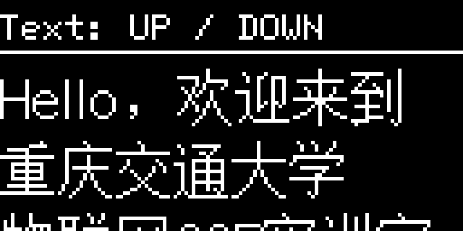
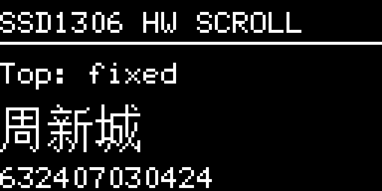
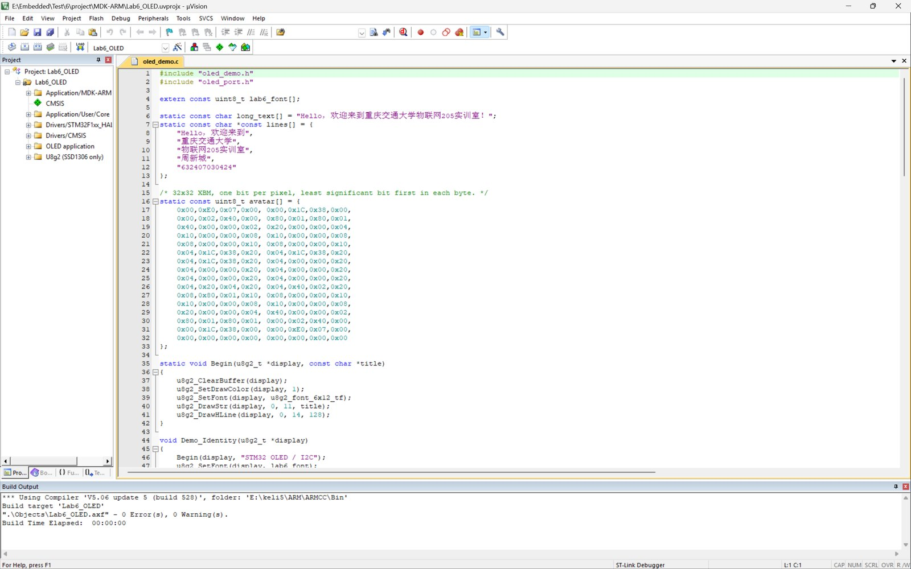
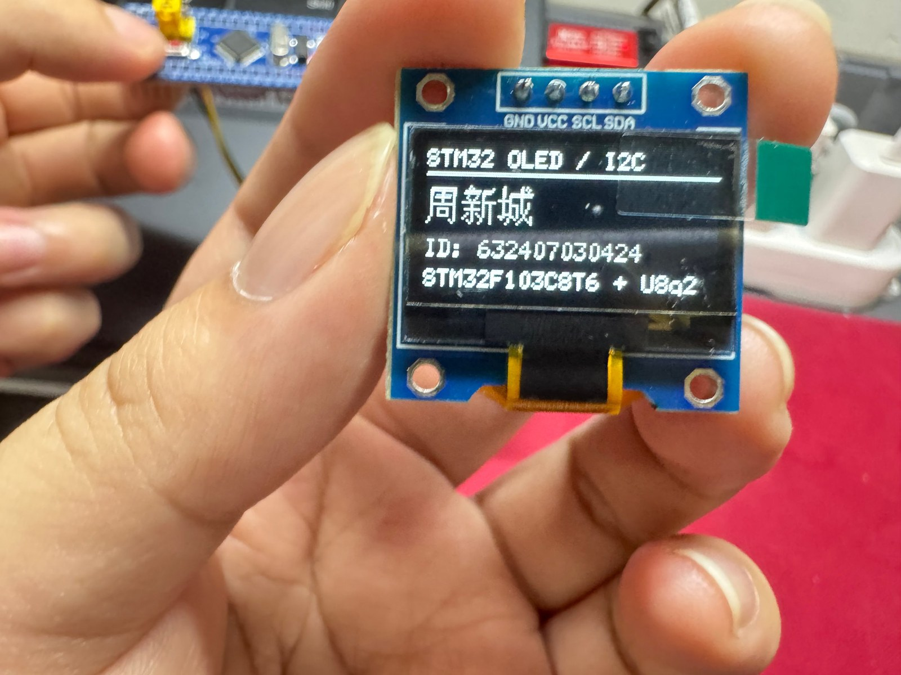
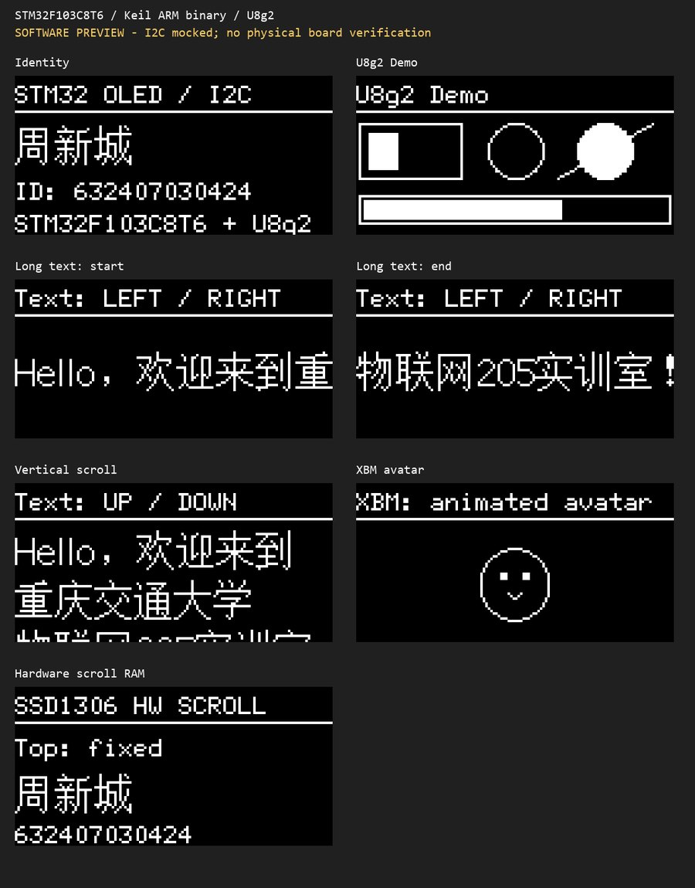

# 0.96 寸 OLED 显示与 U8g2 移植实验报告

**课程：** 嵌入式系统实验  
**姓名：** 周新城  
**学号：** 632407030424  
**专业班级：** 物联网工程  
**实验日期：** 2026 年 10 月 26 日  
**实验地点：** 重庆交通大学物联网 205 实训室  
**实验平台：** STM32F103C8T6 + 0.96 寸 I2C OLED（SSD1306，128×64）

---

## 一、实验目的

1. 理解 I2C 总线的基本原理、开漏电气结构、起始/停止条件、应答机制和读写时序。
2. 掌握 0.96 寸 OLED 的显存组织方式、SSD1306 命令体系，以及汉字点阵的生成与显示方法。
3. 掌握 U8g2 开源图形库在 STM32 HAL 工程中的裁剪、移植和调用方法。
4. 完成姓名学号显示、长字符串滚动、图形 demo、四方向文字移动和动态图案显示，并对 Keil 虚拟逻辑分析仪的测量边界形成清楚认识。

## 二、实验环境与器材

| 类别 | 名称 | 说明 |
| --- | --- | --- |
| 主控 | STM32F103C8T6 最小系统板 | LQFP48，64 KB Flash，20 KB RAM，HSI 8 MHz |
| 显示 | 0.96 寸 OLED 模块 | 128×64 单色，四针 I2C，SSD1306 控制器 |
| 调试 | ST-LINK V2 | SWD 接口，用于下载与校验 |
| IDE | Keil µVision 5 | ARM Compiler 5.06 update 5（ARMCC5） |
| 配置工具 | STM32CubeMX 6.18.1 | STM32Cube FW_F1 V1.8.0 |
| 图形库 | U8g2 | 上游提交 `d6c8499`，仅使用 C 源码 |
| 字库 | 文泉驿点阵宋体 0.9.9.8 | 16 像素 BDF，按实验字符裁剪 |
| 辅助 | Unicorn、Pillow | 仅用于 PC 端软件核对，不参与固件编译 |

引脚连接如下。接线以模块丝印为准，不按杜邦线颜色判断。

| OLED 引脚 | STM32F103C8T6 | 说明 |
| --- | --- | --- |
| GND | GND | 共地 |
| VCC | 3.3 V | 不要接 5 V |
| SCL | PB10 / I2C2_SCL | 开漏，需上拉 |
| SDA | PB11 / I2C2_SDA | 开漏，需上拉 |

模块通常自带上拉电阻；若没有，SCL、SDA 各接 4.7 kΩ 到 3.3 V。开发板与 ST-LINK 只保留一个 3.3 V 供电源，避免双电源倒灌。

## 三、实验原理

### 3.1 I2C 总线

I2C 使用 SCL、SDA 两根开漏信号线，外部上拉电阻保证空闲时为高电平。总线上的器件通过“线与”共享信号：任一器件把线拉低，整条线就是低电平。

协议层的关键状态：

- **起始条件（START）：** SCL 为高时，SDA 由高变低；
- **停止条件（STOP）：** SCL 为高时，SDA 由低变高；
- **数据有效：** SCL 为高期间 SDA 必须稳定，数据只能在 SCL 低期间改变；
- **应答（ACK）：** 每 8 位数据后的第 9 个时钟，从机把 SDA 拉低表示收到，释放为高表示 NACK。

本实验的 OLED 七位地址为 `0x3C`，写方向左移一位后是 `0x78`。HAL 库和 U8g2 的地址参数都按八位地址处理，因此代码里写 `0x3C << 1`。部分模块使用 `0x3D`，初始化时通过 `HAL_I2C_IsDeviceReady()` 探测并在两者之间回退。

一次典型的 OLED 写事务包含：START、地址字节、ACK、控制字节、ACK、命令或数据、STOP。控制字节 `0x00` 表示后续为命令流，`0x40` 表示后续为显存数据流。U8g2 的 `u8x8_cad_ssd13xx_fast_i2c` 会自动插入控制字节，移植层只需要负责把字节数组通过 HAL 发出去。

### 3.2 SSD1306 显存与命令

128×64 单色屏按每像素 1 bit 计算，全屏数据量为：

```
128 × 64 ÷ 8 = 1024 字节
```

SSD1306 把垂直方向相邻的 8 个像素组成一个字节，整个屏幕分为 8 页（page 0～7），每页 128 列。字节的 bit0 对应页内最上面的像素，bit7 对应最下面。写显存时需要先设置页地址和列地址，再连续写入数据。

常用命令：

| 命令 | 作用 |
| --- | --- |
| `0xAE` / `0xAF` | 关显示 / 开显示 |
| `0x20` | 设置寻址模式 |
| `0xB0`～`0xB7` | 设置页地址 |
| `0x00`～`0x0F` / `0x10`～`0x1F` | 设置列地址低/高四位 |
| `0x26` / `0x27` | 水平向右 / 向左滚动 |
| `0x2E` / `0x2F` | 停止 / 启动滚动 |
| `0x81` | 设置对比度 |

U8g2 初始化时会发送完整的 SSD1306 上电序列，应用层不需要逐条手写。只有硬件滚动这类 U8g2 没有封装的命令，才需要直接通过 HAL 发送。

### 3.3 汉字点阵与字符编码

汉字在源文件中以 UTF-8 保存，一个常用汉字通常占 3 个字节。UTF-8 只是字符编号，不是像素数据。显示时需按 Unicode 码点找到字库中的点阵，再逐位写入显存。

16 像素汉字的一个字形通常为 16×16 像素，占：

```
16 × 16 ÷ 8 = 32 字节
```

字库文件由 BDF 描述每个字符的包围盒和点阵行。U8g2 自带的 `bdfconv` 可以把 BDF 转成压缩的 C 数组，运行时由 `u8g2_DrawUTF8()` 解码 UTF-8、查表并绘制。

本次只保留实验需要的字符：95 个 ASCII 加 21 个非 ASCII 字符（周、新、城、欢、迎、来、到、重、庆、交、通、大、学、物、联、网、实、训、室、！、，）。生成字库 2259 字节。这个子集是封闭的：修改显示内容时，如果新增字符不在子集内，必须重新生成字库，不能只改字符串。

### 3.4 U8g2 的层次与移植接口

U8g2 分为三层：

1. **应用层**：`u8g2_DrawStr()`、`u8g2_DrawUTF8()`、`u8g2_DrawBox()`、`u8g2_DrawCircle()`、`u8g2_DrawXBM()` 等绘图 API；
2. **驱动层**：`u8x8_d_ssd1306_128x64_noname.c` 描述控制器命令，`u8x8_cad.c` 负责命令/数据封装；
3. **适配层**：字节传输回调和延时回调，由用户实现。

移植的核心是提供两个回调：

- `u8x8_msg_cb byte_cb`：处理 `U8X8_MSG_BYTE_START_TRANSFER`、`U8X8_MSG_BYTE_SEND`、`U8X8_MSG_BYTE_END_TRANSFER` 等消息；
- `u8x8_msg_cb gpio_and_delay_cb`：处理毫秒、10 微秒、100 纳秒级延时。

本实验使用 `u8g2_Setup_ssd1306_i2c_128x64_noname_f()`，`_f` 表示全屏缓冲。U8g2 在 RAM 中维护 1024 字节显存副本，所有绘图先写副本，最后 `u8g2_SendBuffer()` 一次性发送。这样刷新时不会看到逐行扫描的撕裂感，代价是占用 1 KB RAM。

### 3.5 软件滚动与硬件滚屏

软件滚动通过改变绘制坐标实现：每帧清屏，把文字画在 `x` 或 `y` 偏移处，再整体发送显存。优点是内容可以比屏幕大，能显示 337 像素宽的长句；缺点是每帧都要重画和重传，CPU 占用高。

硬件滚屏由 SSD1306 内部完成：写入滚动设置命令后，控制器自己移动显存内容，MCU 不用反复写显存。缺点是只能移动已经存在于显存中的内容，不能显示比 1024 字节显存更大的画面；停止滚动后还要重写显存，恢复显示指针。

## 四、实验内容与过程

### 4.1 CubeMX 建立 HAL 框架

在 CubeMX 中新建 `STM32F103C8Tx` 工程，完成以下配置：

1. `System Core → SYS → Debug` 选择 `Serial Wire`，保留 PA13/PA14 作为 SWDIO/SWCLK；
2. `Connectivity → I2C2` 选择 `I2C`，PB10 配置为 SCL，PB11 配置为 SDA；
3. I2C2 参数选择 Fast Mode，Clock Speed 400000 Hz，Fast Mode Duty Cycle 为 2；
4. RCC 选择 HSI，PLL Source 为 HSI/2，PLLMul 为 ×16，SYSCLK 为 64 MHz；
5. APB1 分频 2（32 MHz），APB2 不分频（64 MHz）；
6. Project Manager 选择 `MDK-ARM V5`，Heap 0x200，Stack 0x800。


使用内部 HSI 经 PLL 得到 64 MHz，不依赖外部晶振，最小系统板没有焊接晶振也能运行。APB1 为 32 MHz，满足 I2C 400 kHz 的时序计算要求。


I2C2 使用快速模式，占空比 2，SCL 低电平时间约为高电平的两倍。相比占空比 16:9，这种配置在长线、慢速上拉时更稳。


生成代码后先编译一次空框架，确认 HAL、启动文件和 Keil 工程本身没有问题，再添加应用代码。自写代码放在 CubeMX 的 `USER CODE` 区域，重新生成时不会被覆盖。

### 4.2 字库生成

从文泉驿点阵宋体 16 像素 BDF 中提取 95 个 ASCII 和 21 个实验用汉字，通过 `bdfconv` 生成 `lab6_font.c`。生成命令的核心参数是字符范围、字体高度和输出数组名；工程里保留了 `Assets/lab6_subset.bdf` 和 `Assets/font_map.txt`，方便后续增删字符。

ASCII 标题和学号使用 U8g2 自带的 `u8g2_font_6x12_tf`，中文使用 `lab6_font`。两套字体通过 `u8g2_SetFont()` 切换。ASCII 字体较矮，适合放标题、学号和说明文字；16 像素字体用于姓名和长句。

### 4.3 姓名与学号显示

第一页布局为：顶部标题、一条横线、中文姓名、学号、芯片型号。坐标按 128×64 屏幕分配，姓名基线在 y=34，学号在 y=50，型号在 y=63。

```c
void Demo_Identity(u8g2_t *display)
{
    Begin(display, "STM32 OLED / I2C");
    u8g2_SetFont(display, lab6_font);
    u8g2_DrawUTF8(display, 0, 34, "周新城");
    u8g2_SetFont(display, u8g2_font_6x12_tf);
    u8g2_DrawStr(display, 0, 50, "ID: 632407030424");
    u8g2_DrawStr(display, 0, 63, "STM32F103C8T6 + U8g2");
}
```

`Begin()` 统一完成清屏、设置绘制色、画标题和分隔线，避免每页重复代码。

```c
static void Begin(u8g2_t *display, const char *title)
{
    u8g2_ClearBuffer(display);
    u8g2_SetDrawColor(display, 1);
    u8g2_SetFont(display, u8g2_font_6x12_tf);
    u8g2_DrawStr(display, 0, 11, title);
    u8g2_DrawHLine(display, 0, 14, 128);
}
```

这一页已在实际硬件上显示，见第六节实拍图。姓名、学号、型号均正常，说明 I2C 地址、初始化序列、字库和显存布局均正确。

### 4.4 长句左右滚动

目标字符串为“Hello，欢迎来到重庆交通大学物联网205实训室！”。按 16 像素字库计算，整句宽度 337 像素，超过屏幕宽度 128 像素，必须滚动显示。

实现方式为每帧改变绘制起点：

```c
void Demo_Horizontal(u8g2_t *display, int16_t x)
{
    Begin(display, "Text: LEFT / RIGHT");
    u8g2_SetClipWindow(display, 0, 17, 128, 64);
    u8g2_SetFont(display, lab6_font);
    u8g2_DrawUTF8(display, x, 43, long_text);
    u8g2_SetMaxClipWindow(display);
}
```

`u8g2_SetClipWindow()` 把绘图区限制在标题线以下，防止文字压到标题。`x` 从 0 递减到 `128 - 337 = -209`，再递增回 0，步长 1 像素，每帧 15 ms。负坐标由 U8g2 的裁剪逻辑处理，屏幕外部分不会写入显存。




### 4.5 上下滚动

上下滚动把五行文字整体沿 y 方向移动，标题保持固定：

```c
void Demo_Vertical(u8g2_t *display, int16_t y)
{
    uint8_t i;
    Begin(display, "Text: UP / DOWN");
    u8g2_SetClipWindow(display, 0, 17, 128, 64);
    u8g2_SetFont(display, lab6_font);
    for (i = 0; i < sizeof(lines) / sizeof(lines[0]); ++i)
        u8g2_DrawUTF8(display, 0, y + i * 20, lines[i]);
    u8g2_SetMaxClipWindow(display);
}
```

`y` 从 63 递减到 -64，再递增回 63。行距 20 像素，16 像素字加 4 像素间隙，五行内容可以完整经过屏幕。绘制顺序为从上到下，先画的内容在后画内容的上方，不需要额外排序。



### 4.6 SSD1306 硬件滚屏

硬件滚屏通过 SSD1306 的滚动命令实现。代码先停止上一次滚动，再设置水平滚动方向和页范围，最后启动：

```c
void OLED_ScrollStart(uint8_t left)
{
    uint8_t command[] = {0x00, 0x2E, 0x27, 0x00, 0x04,
                         0x00, 0x07, 0x00, 0xFF, 0x2F};
    command[2] = left ? 0x27 : 0x26;
    oled_i2c_status = HAL_I2C_Master_Transmit(
        &hi2c2, oled_address, command, sizeof(command), 100);
}
```

命令字节含义：

| 字节 | 含义 |
| --- | --- |
| `0x00` | 控制字节，后续为命令 |
| `0x2E` | 停止滚动 |
| `0x27` / `0x26` | 向左 / 向右滚动 |
| `0x00` | 虚拟字节 |
| `0x04` | 起始页 4 |
| `0x00` | 滚动间隔 |
| `0x07` | 结束页 7 |
| `0x00`、`0xFF` | 虚拟字节 |
| `0x2F` | 启动滚动 |

页范围 4～7 对应屏幕下半部分，上半部分保持固定。停止滚动后重新发送 1024 字节显存，避免显示指针错位：

```c
OLED_ScrollStop();
u8g2_SendBuffer(display);
```



硬件滚屏适合整页内容平移；长句滚动仍然采用软件坐标移动，因为 337 像素宽的内容无法一次性放入 1024 字节显存。

### 4.7 U8g2 裁剪与移植

从 U8g2 上游获取源码后，只保留 SSD1306、128×64、I2C、全屏缓冲所需模块，删除 Arduino 封装、C++ 示例、其他控制器驱动和未使用字体。保留的源文件分为三组：

- 绘图与字体：`u8g2_box.c`、`u8g2_circle.c`、`u8g2_line.c`、`u8g2_bitmap.c`、`u8g2_font.c`、`u8g2_hvline.c`、`u8g2_polygon.c`、`u8g2_arc.c` 等；
- 驱动与协议：`u8x8_d_ssd1306_128x64_noname.c`、`u8x8_cad.c`、`u8x8_byte.c`、`u8x8_display.c`、`u8x8_setup.c`、`u8x8_gpio.c`；
- 初始化与缓冲：`u8g2_d_setup.c`、`u8g2_d_memory.c`、`u8g2_setup.c`、`u8g2_buffer.c`、`u8g2_cleardisplay.c`。

`u8g2_d_setup.c` 只保留一个初始化函数：

```c
void u8g2_Setup_ssd1306_i2c_128x64_noname_f(
    u8g2_t *u8g2, const u8g2_cb_t *rotation,
    u8x8_msg_cb byte_cb, u8x8_msg_cb gpio_and_delay_cb)
{
    uint8_t tile_buf_height;
    uint8_t *buf;
    u8g2_SetupDisplay(u8g2, u8x8_d_ssd1306_128x64_noname,
                      u8x8_cad_ssd13xx_fast_i2c,
                      byte_cb, gpio_and_delay_cb);
    buf = u8g2_m_16_8_f(&tile_buf_height);
    u8g2_SetupBuffer(u8g2, buf, tile_buf_height,
                     u8g2_ll_hvline_vertical_top_lsb, rotation);
}
```

`u8g2_m_16_8_f()` 提供 1024 字节静态缓冲：

```c
uint8_t *u8g2_m_16_8_f(uint8_t *page_cnt)
{
    static uint8_t buf[1024];
    *page_cnt = 8;
    return buf;
}
```

字节回调把 U8g2 的多次 `SEND` 消息累积到一个 128 字节数组，在 `END_TRANSFER` 时调用一次 `HAL_I2C_Master_Transmit()`。这样既减少 I2C 事务次数，也避免 HAL 调用过于频繁。

```c
case U8X8_MSG_BYTE_SEND:
    if (used + count > sizeof(buffer))
    {
        oled_i2c_status = HAL_ERROR;
        return 0;
    }
    memcpy(buffer + used, data, count);
    used += count;
    return 1;
case U8X8_MSG_BYTE_END_TRANSFER:
    oled_i2c_status = HAL_I2C_Master_Transmit(
        &hi2c2, oled_address, buffer, used, 100);
    return oled_i2c_status == HAL_OK;
```

延时回调中，毫秒级用 `HAL_Delay()`，10 微秒和 100 纳秒级用 DWT 周期计数器忙等。使用前使能 DWT：

```c
CoreDebug->DEMCR |= CoreDebug_DEMCR_TRCENA_Msk;
DWT->CTRL |= DWT_CTRL_CYCCNTENA_Msk;
```

64 MHz 下 10 µs 对应 640 个周期，DWT 精度足够。U8g2 的 SSD1306 启动序列包含微秒级等待，全部用 `HAL_Delay(0)` 代替并不可靠。

初始化时先探测地址：

```c
uint8_t OLED_Init(u8g2_t *display)
{
    oled_address = 0x3C << 1;
    HAL_Delay(100);
    if (HAL_I2C_IsDeviceReady(&hi2c2, oled_address, 2, 20) != HAL_OK)
    {
        oled_address = 0x3D << 1;
        if (HAL_I2C_IsDeviceReady(&hi2c2, oled_address, 2, 20) != HAL_OK)
            return 0;
    }
    u8g2_Setup_ssd1306_i2c_128x64_noname_f(
        display, U8G2_R0, I2C_Byte, GPIO_Delay);
    u8g2_SetI2CAddress(display, oled_address);
    u8g2_InitDisplay(display);
    u8g2_SetPowerSave(display, 0);
    u8g2_ClearBuffer(display);
    return oled_i2c_status == HAL_OK;
}
```

主循环前反复初始化，直到屏幕应答：

```c
while (!OLED_Init(&display))
{
    HAL_Delay(500);
}
```

### 4.8 图形 demo

U8g2 demo 页绘制边框、实心矩形、圆、实心圆、直线和进度条，覆盖常用绘图 API。进度条长度按帧计数取模，形成循环动画。

```c
u8g2_DrawFrame(display, 1, 19, 42, 23);
u8g2_DrawBox(display, 5, 23, 12, 15);
u8g2_DrawCircle(display, 64, 30, 11, U8G2_DRAW_ALL);
u8g2_DrawDisc(display, 100, 30, 3 + frame % 9, U8G2_DRAW_ALL);
u8g2_DrawLine(display, 81, 41, 119, 19);
u8g2_DrawFrame(display, 1, 48, 126, 12);
u8g2_DrawBox(display, 3, 50, frame % 123, 8);
```


### 4.9 XBM 图案与动画

图案为 32×32 XBM 点阵笑脸。XBM 每个字节按低位优先表示横向 8 个像素，`u8g2_DrawXBM()` 将其转换为 SSD1306 的页式布局。

动画由帧计数驱动：图案水平往返运动，同时上下浮动；每 30 帧中的前 5 帧擦除眼睛区域并画一条横线，形成眨眼。擦除用绘制色 0，恢复用绘制色 1。

```c
void Demo_Avatar(u8g2_t *display, uint16_t frame)
{
    int16_t x = frame % 144;
    int16_t y;
    if (x > 72) x = 144 - x;
    y = 22 + (frame % 20 < 10 ? frame % 10 : 10 - frame % 10);
    Begin(display, "XBM: animated avatar");
    u8g2_DrawXBM(display, x + 12, y, 32, 32, avatar);
    if (frame % 30 < 5)
    {
        u8g2_SetDrawColor(display, 0);
        u8g2_DrawBox(display, x + 20, y + 10, 16, 3);
        u8g2_SetDrawColor(display, 1);
        u8g2_DrawHLine(display, x + 21, y + 11, 3);
        u8g2_DrawHLine(display, x + 33, y + 11, 3);
    }
}
```


### 4.10 显示顺序

上电后程序自动循环，不需要按键：

1. 姓名学号页，停留 3 秒；
2. U8g2 图形 demo，123 帧，每帧 20 ms；
3. 长句先向左、再向右滚动；
4. 多行中文与学号先向上、再向下滚动；
5. 32×32 图案左右往返、上下浮动并眨眼；
6. SSD1306 硬件左滚、右滚各约 4 秒，上半屏固定。

## 五、编译与烧录结果

Keil 工程使用 ARMCC5，C99，优化等级 O3，预定义宏 `USE_HAL_DRIVER, STM32F103xB`。中文源文件以 UTF-8 保存，并在 C/C++ 选项中加 `--no_multibyte_chars`，避免 ARMCC 按本地代码页解释字符串。

完整重建结果：

```text
Program Size: Code=11648 RO-data=5204 RW-data=28 ZI-data=4044
".\Objects\Lab6_OLED.axf" - 0 Error(s), 0 Warning(s).
Build Time Elapsed: 00:00:05
```

| 项目 | 数值 |
| --- | --- |
| Code | 11648 字节 |
| RO-data | 5204 字节 |
| RW-data | 28 字节 |
| ZI-data | 4044 字节 |
| Flash 占用 | 约 16.5 KiB |
| 静态 RAM | 约 4 KiB（含栈、堆、1024 字节显存缓冲） |



HEX 文件从 `0x08000000` 开始，使用 ST-LINK 通过 SWD 下载。实际烧录输出：

```text
Erase Done.
Programming Done.
Verify OK.
Flash Load finished at 20:10:16
```


## 六、显示结果与验证

### 6.1 实物显示

姓名学号页已在硬件上显示，实拍如下。屏幕内容为“STM32 OLED / I2C”“周新城”“ID: 632407030424”“STM32F103C8T6 + U8g2”，中文没有缺字，学号完整，标题与分隔线位置正常。



实拍图说明固件已经运行，I2C 通信、SSD1306 初始化、字库查表和显存写入均正常。由于拍摄条件限制，长句滚动、上下滚动、图形 demo、动画和硬件滚屏没有逐页拍照，下面用软件核对图说明其内容。

### 6.2 软件核对

使用 Unicorn 加载编译后的 AXF，把 HAL I2C 和延时替换为桩函数，直接调用显示函数，再将 1024 字节显存还原为 128×64 位图。检查项如下：

| 检查项 | 结果 |
| --- | --- |
| `0x3C` 地址初始化 | 通过 |
| `0x3D` 地址回退 | 通过 |
| 无屏时返回失败 | 通过 |
| 21 个汉字字模存在 | 通过 |
| 长句宽度 337 像素 | 通过 |
| 负坐标水平裁剪 | 通过 |
| 上下滚动时标题保持 | 通过 |
| 图案帧变化与眨眼 | 通过 |
| SSD1306 滚动命令字节 | 通过 |



软件核对验证的是坐标、字模、裁剪和命令序列，不验证 SCL/SDA 的实际电平、上升沿、ACK 时序和 OLED 控制器批次差异。文中除实拍图外的屏幕图均来自这套渲染，不是实物照片。

### 6.3 任务完成情况

| 任务 | 内容 | 状态 |
| --- | --- | --- |
| 任务一 | 显示学号与姓名 | 完成，已上板 |
| 任务一 | 显示 AHT20 温湿度 | 未完成，手头无 AHT20 模块，固件未接入 |
| 任务一 | 长句左右滚动 | 完成，软件核对 |
| 任务一 | 上下滚动 | 完成，软件核对 |
| 任务二 | 示波器/逻辑分析仪实测 | 按课程安排本次不做 |
| 任务三 | U8g2 demo | 完成，软件核对 |
| 任务三 | 学号姓名（U8g2） | 完成，已上板 |
| 任务三 | 上下、左右滚动 | 完成，软件核对 |
| 任务三 | 图案与动态效果 | 完成，XBM 笑脸，软件核对 |

## 七、问题与解决

| 问题 | 现象 | 原因 | 解决 |
| --- | --- | --- | --- |
| 中文编译失败或乱码 | 字符串显示为问号、方块，或编译报错 | 源文件编码与编译器多字节处理不一致 | 源文件统一 UTF-8，加 `--no_multibyte_chars` |
| `U8G2_16BIT` 重定义 | 编译报重复定义 | 上游头文件与工程配置各定义一次 | 删除重复定义，保留一处 |
| 未定义符号 | 链接报 `u8x8_capture` 相关函数缺失 | 裁剪时漏掉 C 文件 | 补回 `u8x8_capture.c` |
| OLED 不亮 | 初始化一直返回失败 | 供电、接线、地址或上拉问题 | 量 3.3 V 与 GND，核对 PB10/PB11，试 `0x3C`/`0x3D` |
| 地址混淆 | 代码写 `0x3C` 但 HAL 无应答 | HAL 需要八位地址 | 使用 `0x3C << 1` |
| 硬件滚屏后花屏 | 停止滚动后内容偏移 | 显示指针未复位 | 停止后重写 1024 字节显存 |
| 文字压住标题 | 滚动时标题被覆盖 | 未设置裁剪窗口 | `u8g2_SetClipWindow()` 限制绘图区 |
| RAM 紧张 | 增大缓冲后栈溢出 | 1024 字节显存加栈堆 | 保持全屏缓冲，减少全局大数组 |

## 八、关于 Keil 虚拟逻辑分析仪

作业提出两个问题：用 Keil 的虚拟逻辑分析仪采集 I2C 的 SDA 引脚会看到什么；如果采不到真实 I2C 协议，可以改用什么方法。

**Keil Logic Analyzer 的定位。** 它跟踪的是调试器能访问的变量或表达式，例如 `GPIOB->ODR`、`PORTB` 或用户自定义的全局变量。它不会自动识别 I2C，也不保证当前芯片包能仿真 I2C 外设和外接 OLED。采样发生在调试器的观察点，受仿真速度、断点和变量更新时机影响，不是真实时间的连续采样。

**如果能看到 SDA 跳变，波形大致是什么样。** 空闲时 SDA 为高。START 时 SCL 为高，SDA 出现下降沿；随后每个 SCL 周期对应一位数据，8 位地址和 8 位数据后各有 1 位应答；STOP 时 SCL 为高，SDA 上升。只观察 SDA，会看到一串宽度不等的低脉冲，START/STOP 与普通数据位不易区分，位边界必须结合 SCL 才能确定。400 kHz 时一位只有 2.5 µs，Keil 仿真采样很可能漏点或混叠，画出来的“波形”不能直接当作总线时序。

**更关键的问题。** GPIO 配置为 I2C 复用开漏后，`ODR` 是输出锁存器，不是引脚实际电平。从机在第 9 个时钟拉低 SDA 表示 ACK，这个低电平不会出现在 `ODR` 中。即使 Logic Analyzer 画出一条看似完整的线，也不能证明总线上真的有 ACK。

**替代方法。**

1. **外部逻辑分析仪。** 同时接 SCL、SDA、GND，采样率不低于总线频率的 10 倍，400 kHz 建议 4 MS/s 以上，开启 I2C 协议解码。可以直接看到地址、数据、ACK 和起止条件。Saleae Logic 16 属于这类工具。
2. **示波器。** 双通道观察 SCL/SDA，触发设在 SDA 下降沿，测量高低电平、上升时间、时钟频率、建立/保持时间。示波器侧重电气特性，逻辑分析仪侧重协议内容。
3. **软件 I2C + 状态指示。** 用 GPIO 模拟 I2C，把每个状态（START、发送位、读 ACK、STOP）用另一个引脚或串口输出。能验证字节序列和状态机，但不是真实总线波形。
4. **第二块 MCU 嗅探。** 一块板子做主机，另一块只读 SCL/SDA，按位采样并通过串口上报。成本低，但采样率和同步精度有限。
5. **读状态寄存器。** 通过 I2C 错误标志、ACK 失败计数定位地址错误、从机无响应等问题，适合功能排查，测不到时序余量。

本次没有用 Keil 的逻辑分析仪声称采到 I2C 波形，也没有任务二的实测数据。上述结论基于调试器工作原理和 I2C 电气特性，不是仪器截图。

## 九、结论与不足

本实验完成了 0.96 寸 I2C OLED 的驱动与显示：姓名学号页已上板显示；长句左右滚动、上下滚动、U8g2 图形 demo、XBM 动态图案和 SSD1306 硬件滚屏均已实现并通过软件核对；U8g2 已按 SSD1306、128×64、I2C、全屏缓冲的需求裁剪并移植到 HAL 工程，编译 0 错误 0 警告，ST-LINK 下载与校验通过。

通过实验，对以下几个点有了更具体的认识：

- I2C 的地址是七位，HAL 和 U8g2 传八位，移位不能漏；
- SSD1306 的显存是页式布局，1024 字节，软件滚动和硬件滚屏的能力边界不同；
- UTF-8 是编码，点阵是字模，两者之间需要字库查表；
- U8g2 的移植本质是提供字节传输和延时两个回调，绘图 API 本身与硬件无关；
- Keil 的逻辑分析仪适合看变量，不适合替代逻辑分析仪测 I2C。

不足与后续工作：

1. AHT20 温湿度未接入。手头没有模块，固件没有伪造数据；后续可在同一条 I2C2 总线上补 `aht20.c`，地址 `0x38`，触发测量后读 6 字节并换算。
2. 任务二未做。没有示波器和逻辑分析仪的实测波形，Keil 虚拟逻辑分析仪的结论来自原理分析。
3. 实物照片只覆盖姓名学号页。长句滚动、demo、动画和硬件滚屏的屏幕图来自软件核对，未逐页拍照；后续可补录视频。
4. 显示控制器按 SSD1306 处理。若实际模块为 SH1106，需要更换 U8g2 驱动并调整列偏移。

## 十、参考资料

1. OLED 屏显与汉字点阵：https://blog.csdn.net/qq_45237293/article/details/111712565
2. OLED 显示原理与字模：https://blog.csdn.net/qq_43279579/article/details/111414037
3. 基于 STM32 移植 U8g2 图形库（HAL 库）：https://blog.csdn.net/black_sneak/article/details/126312657
4. U8g2 源码与文档：https://github.com/olikraus/u8g2
5. 文泉驿点阵宋体：https://github.com/olikraus/u8g2/tree/d6c8499c5f2707cac8eccd09fd8f677d12b17977/tools/font/bdf
6. SSD1306 数据手册：Solomon Systech，128×64 Dot Matrix OLED/PLED Segment/Common Driver with Controller
7. STM32F103x8/xB 数据手册与参考手册：STMicroelectronics
8. 完整工程与过程材料：https://github.com/Gallagher1201/stm32-oled-u8g2-lab6
